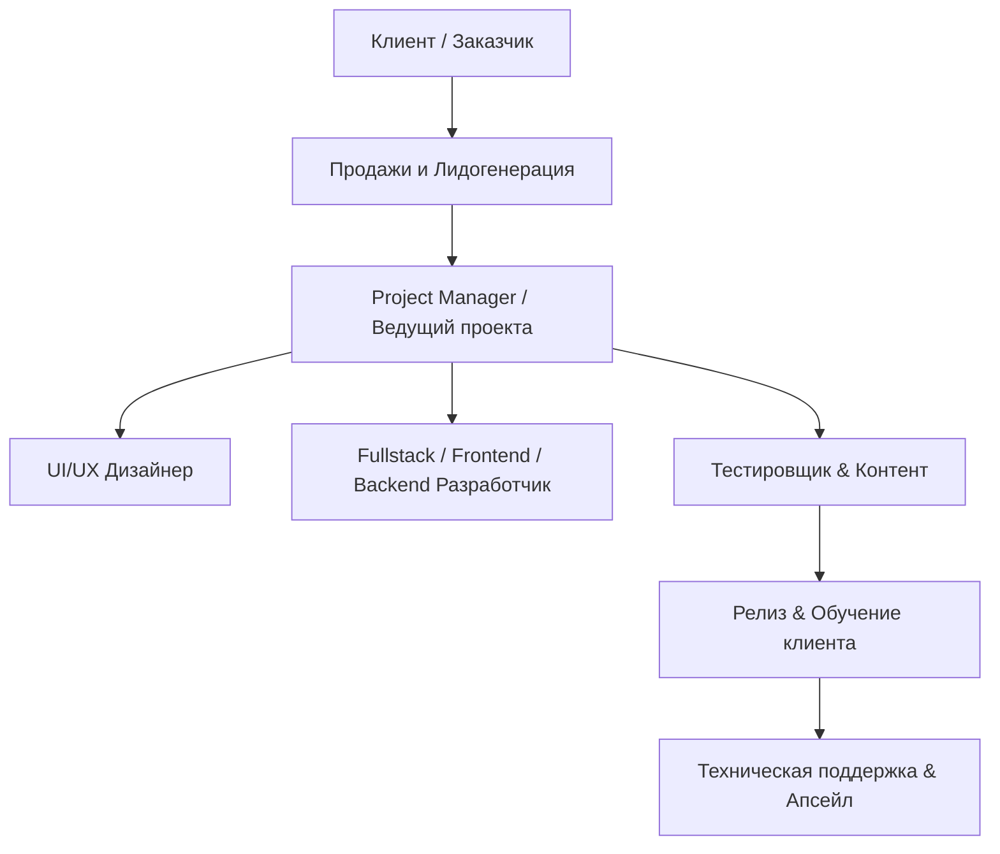

# 📘 Shuaq Agency Blueprint: Полное руководство IT-агентства по созданию сайтов

> **Настольная книга основателя агентства Shuaq (Шуақ)**  
> Практическое руководство от А до Я: как устроено IT-агентство, как продавать, вести проекты, выстраивать производство и защищать бизнес от факапов.

---

## 🧭 Навигация по разделам

1. [Введение: Суть и структура IT-агентства](#1-введение-суть-и-структура-it-агентства)
2. [Позиционирование и УТП Shuaq: почему купят у нас](#2-позиционирование-и-утп-shuaq)
3. [Продуктовая матрица и услуги (Что именно продавать)](#3-продуктовая-матрица-и-услуги)
4. [Ценообразование и финансовая модель (Как считать деньги)](#4-ценообразование-и-финансовая-модель)
5. [Воронка продаж и лидогенерация (Где брать клиентов)](#5-воронка-продаж-и-лидогенерация)
6. [Скрипты общения и квалификация заказчика (BANT)](#6-скрипты-общения-и-квалификация-заказчика)
7. [Производственный пайплайн: 6 шагов от брифа до релиза](#7-производственный-пайплайн-6-шагов)
8. [Юридическая безопасность, договор и регламент правок](#8-юридическая-безопасность-и-договор)
9. [Поддержка и Recurring Revenue (LTV клиента)](#9-поддержка-и-lvt-клиента)
10. [Стек инструментов агентства](#10-стек-инструментов-агентства)

---

## 1. Введение: Суть и структура IT-агентства

IT-агентство по созданию сайтов — это **бизнес по решению бизнес-задач клиента с помощью цифровых технологий**.  
Заказчик покупает не строчки кода на JavaScript или верстку, а:
* Увеличение заявок и продаж (конверсия сайта);
* Укрепление имиджа компании (дизайн уровня лидеров рынка);
* Автоматизацию рутины (клиенты заказывают сами, данные летят в CRM/Telegram);
* Спокойствие и надежность (сдача в срок, гарантия, без исчезновений разработчика).

### Базовая структура ролей в агентстве (от соло-старта к команде)



* **На старте (Соло-фаундер):** Вы совмещаете роли PM, продажника и ведущего разработчика. Это абсолютно нормально! 90% успешных студий начинались с одного сильного инженера.
* **На этапе роста ($3,000+ / месяц):** Первым нанимается фриланс-дизайнер (Figma) или помощник-верстальщик, освобождая ваше время для продаж и архитектуры.

---

## 2. Позиционирование и УТП Shuaq

На рынке тысячи фрилансеров, которые собирают однотипные сайты на Tilda/Wix.  
**УТП Shuaq (Уникальное Торговое Предложение):**

> **«Инженерная студия цифровых продуктов: премиальный визуальный стиль Apple & Arc + чистый рабочий код (Full-stack, AI, интеграции) без ограничений шаблонных конструкторов».**

### 4 столпа нашего преимущества:
1. **Эстетика мирового уровня:** Воздушный стиль Cloud Horizon, Liquid Glass, микро-анимации, премиальная типографика (Plus Jakarta Sans). Сайт выглядит дорого с первых секунд.
2. **Инженерная глубина:** Мы делаем не просто "картинку", а системы: авторизация пользователей, личные кабинеты, базы данных (PostgreSQL), интеграция с Telegram-ботами, парсерами и AI-моделями.
3. **Прозрачность и контроль:** Заказчик видит статус проекта, получает понятные этапы, исходный код на GitHub и рабочую ссылку для тестирования.
4. **Скорость и фокус:** За счет готовых модулей и выстроенного пайплайна запускаем проекты от 7 до 21 дня.

---

## 3. Продуктовая матрица и услуги

Клиент должен четко понимать, что именно он может купить. Нельзя предлагать просто «сайты». Предлагайте конкретные упакованные решения.

| Продукт | Кому подходит | Что входит | Срок | Ориентир цены (KZ/CIS) |
| :--- | :--- | :--- | :--- | :--- |
| 🚀 **Промо-лендинг (Landing Page)** | Для старта рекламы, нового товара, услуги или мероприятия | 1 длинная страница (6-9 блоков), адаптив под смартфоны, анимации, форма заявок в Telegram/Email, базовая SEO | 5–10 дней | 120 000 – 250 000 ₸ ($250 – $550) |
| 🏢 **Корпоративный сайт** | Компаниям с историей, юристам, клиникам, строителям, B2B | 4–8 страниц (Главная, О компании, Услуги, Кейсы/Портфолио, Блог, Контакты), CMS/админка | 14–25 дней | 250 000 – 550 000 ₸ ($550 – $1,200) |
| 🛒 **Интернет-магазин / Каталог** | Ритейлу, брендам одежды, доставке, крафтовым производствам | Каталог товаров с фильтрами, карточки товара, корзина, интеграция Kaspi Pay / Stripe, уведомления в TG | 20–35 дней | 400 000 – 900 000 ₸ ($900 – $2,000) |
| ⚡ **Web-сервис / SaaS / Личный кабинет** | Стартапам, логистике, агро-проектам, онлайн-школам | Авторизация (JWT), дашборды с графиками, роли (клиент/админ), база данных, сложная бизнес-логика | 1–2 месяца | от 800 000 ₸+ ($1,700+) |
| 🧠 **AI-бот & Автоматизация** | Любому бизнесу, где менеджеры устают отвечать в WhatsApp/TG | Умный Telegram-бот на базе LLM с базой знаний компании, квалификация лида, авто-запись | 5–14 дней | 150 000 – 400 000 ₸ ($350 – $900) |

---

## 4. Ценообразование и финансовая модель

### Правило расчета сметы:
Никогда не называйте цену «на глаз». Смета считается по формуле:

$$\text{Итоговая цена} = (\text{Часы работы} \times \text{Ставка часа}) \times \text{Коэффициент рисков (1.3)} + \text{Стоимость сторонних сервисов}$$

* *Пример:* Лендинг занимает ~30 часов чистой работы. При ставке 5,000 ₸/час:  
  $30 \times 5000 = 150\,000 \times 1.3 = 195\,000$ ₸. Округляем до понятных 190 000 – 200 000 ₸.

### Условия оплаты (Строгое правило!):
* **Никакой работы без предоплаты!**
* Стандарт агентства: **50% предоплата** до начала работ, **50% финальный платеж** перед переносом на домен клиента и передачей доступов.
* Для крупных проектов от 500 000 ₸: схема **30% / 40% / 30%** (30% старт, 40% после утверждения дизайна и демо-верстки, 30% перед релизом).

---

## 5. Воронка продаж и лидогенерация

Как начинающему агентству получать клиентов без гигантских бюджетов на рекламу:

### Канал 1. Тёплый круг и сарафанка (Быстрые деньги)
* Напишите всем знакомым предпринимателям: «Привет! Мы открыли студию Shuaq, делаем современные веб-сервисы и сайты уровня Apple. Если планируете обновлять сайт или запускать рекламу — сделаем бесплатный аудит текущего сайта или прототип со скидкой 30% за первый кейс».

### Канал 2. Точечный холодный аутрич (Direct Outreach в Telegram/Instagram)
1. Находите бизнес в Instagram / 2GIS с устаревшим сайтом или сайтом без мобильной адаптации.
2. Делаете 2-минутное видео через Loom/Telegram Video:
   * *«Здравствуйте! Заметил, что у вас крутой продукт, но мобильная версия сайта открывается некорректно, а кнопка заказа не работает. Я набросал 1 экран, как это может выглядеть в современной эстетике. Если интересно взглянуть, маякните!»*
3. Конверсия таких персонализированных сообщений в созвон составляет **15–25%**.

### Канал 3. Демонстрация процесса (Build in Public)
* Публикуйте в Telegram/LinkedIn короткие видео: как вы верстаете интерфейс, как работает анимация, разбор интересных фич. Клиенты любят заказывать у тех, кто горит своим делом.

### Канал 4. Партнерка с маркетологами и таргетологами
* Таргетологам постоянно нужны качественные посадочные страницы для клиентов, иначе их реклама сливается. Предложите им 10–15% комиссии с каждого приведенного клиента на разработку сайта.

---

## 6. Скрипты общения и квалификация заказчика (BANT)

Когда клиент написал: *«Сколько стоит сайт?»* — **НИКОГДА** не отвечайте просто числом!  
Если назвать цену сразу, клиент уйдет сравнивать с дешевыми шаблонными сборщиками.

### Правильный ответ:
> *«Добрый день, [Имя]! Стоимость зависит от задачи: простой промо-сайт под рекламу мы запускаем за 150–200 тыс. ₸ за 7 дней, а корпоративный портал с личным кабинетом — от 350 тыс. ₸.  
> Чтобы я не называл цифр с потолка и предложил именно то, что окупится вашему бизнесу: подскажите, какая главная цель сайта (запуск рекламы, презентация инвесторам или автоматизация заказов)?»*

### Квалификация по формуле BANT:
* **B (Budget):** Есть ли у клиента понимание бюджета?
* **A (Authority):** Вы говорите с владельцем (ЛПР) или помощником, который ничего не решает?
* **N (Need):** Какая реальная боль? (Мало заявок, старый сайт стыдно показать, менеджеры не успевают отвечать).
* **T (Timeline):** Когда нужен запуск? (Если «вчера» — можно делать наценку 30% за срочность).

---

## 7. Производственный пайплайн: 6 шагов

```
[1. Бриф и ТЗ] ──> [2. Прототип (UX)] ──> [3. Дизайн (UI)] ──> [4. Разработка] ──> [5. QA & Контент] ──> [6. Релиз]
```

### Шаг 1. Бриф и ТЗ (1–2 дня)
* Заполнение брифа (онлайн-форма на сайте Shuaq или 20-минутный созвон в Google Meet / Telegram).
* Фиксация списка страниц, обязательных блоков и интеграций.
* Согласование сметы и подписание договора. Получение 50% предоплаты.

### Шаг 2. Прототипирование / Смысловая структура (2–4 дня)
* Создание схемы сайта: какие заголовки, где какие кнопки, какой текст в карточках.
* Утверждение с клиентом структуры текста до того, как рисовать красивый дизайн. Это экономит недели времени!

### Шаг 3. UI-Дизайн (3–7 дней)
* Отрисовка концепта первого экрана в фирменном стиле (шрифты, цвета, градиенты).
* Согласование стиля -> отрисовка остальных блоков и адаптива под экраны iPhone/Android.
* Презентация клиенту в формате скринкаста с объяснением, почему сделано именно так.

### Шаг 4. Разработка и программирование (5–12 дней)
* Верстка фронтенда (чистый HTML/CSS/JS или React).
* Настройка адаптивности (проверка на экранах от 360px до 4K).
* Разработка бэкенда: отправка заявок в Telegram-бот заказчика, запись в базу, подключение API.
* Промежуточная демо-ссылка (например, на Vercel/Render): клиент может покликать живой сайт на телефоне.

### Шаг 5. Тестирование (QA) и наполнение (2–3 дня)
* Проверка всех кнопок, форм, полей валидации, валидности ссылок.
* Замер скорости через Google PageSpeed Insights (цель: зеленые зоны 85–98 баллов).
* Наполнение реальными фото и текстами заказчика (никаких «Lorem Ipsum» на релизе).

### Шаг 6. Сдача проекта, релиз и обучение (1–2 дня)
* Получение оставшихся 50% оплаты.
* Привязка официального домена клиента (например, `client-company.kz`) и выпуск бесплатного SSL-сертификата HTTPS.
* Запись 5-минутного видео: «Как пользоваться сайтом и где смотреть заявки».
* Запрос отзыва в Telegram / WhatsApp.

---

## 8. Юридическая безопасность, договор и регламент правок

Главный страх начинающих студий: **клиент требует бесконечные правки 6 месяцев подряд**.  
Как этого избежать:

### 1. Правило двух итераций правок
В договоре и переписке четко фиксируется:
> *«На каждом этапе (Прототип, Дизайн, Верстка) клиенту предоставляется 2 комплексные итерации правок. Заказчик собирает все пожелания в единый список. Новые хотелки, выходящие за рамки первоначального ТЗ, оцениваются и оплачиваются отдельно как доработки».*

### 2. Сдача по этапам
Каждый этап закрывается письменным подтверждением в мессенджере или актом:
* Утвердили дизайн? Возврат к переделке дизайна во время программирования — платный.

### 3. Хостинг и доступы
* Разработку ведите на своих серверах/аккаунтах (Vercel, Render, ваш GitHub).
* Финальные доступы и перенос на домен клиента передаются **только после 100% оплаты**.

---

## 9. Поддержка и LTV клиента (Recurring Revenue)

Сайт сдали — работа не заканчивается! Повторные продажи приносят студиям до 50% чистой прибыли.

### Что продавать после релиза:
1. **Пакет технического сопровождения (Retainer):**
   * 30 000 – 70 000 ₸/месяц ($70–$150).
   * Входит: оплата хостинга, мониторинг работоспособности 24/7, резервное копирование, до 3 часов мелких правок в месяц (замена цен, баннеров, новостей).
2. **SEO-базовая оптимизация и ускорение:** настройка индексации в Google/Yandex, микроразметка Schema.org.
3. **Разработка Telegram-бота:** автоматизация рассылок или клиентской поддержки.
4. **Контекстная и таргет-реклама:** работа в связке с проверенным маркетологом за процент.

---

## 10. Стек инструментов агентства

| Задача | Инструмент | Зачем используется |
| :--- | :--- | :--- |
| **Дизайн и прототипы** | Figma | Отрисовка интерфейсов, передача макетов в код |
| **Разработка** | VS Code / Antigravity IDE, Git, GitHub | Написание чистого кода, контроль версий |
| **Frontend** | HTML5, Modern CSS (Glassmorphism, CSS Grid), React / Next.js, TypeScript | Красивые и быстрые интерфейсы |
| **Backend & API** | Node.js (Express), Python (FastAPI), PostgreSQL, SQLite | Обработка заказов, авторизация, базы данных |
| **Деплой и хостинг** | Vercel (frontend), Render / Fly.io (backend), Cloudflare | Мгновенный деплой, SSL, защита от DDoS |
| **Оповещения** | Telegram Bot API | Мгновенная доставка лидов менеджеру и клиенту |
| **Управление задачами** | Notion, Trello | Трекинг этапов проектов, базы знаний |
| **Связь с клиентами** | Telegram, Google Meet, Loom | Быстрые созвоны и видео-скринкасты |
